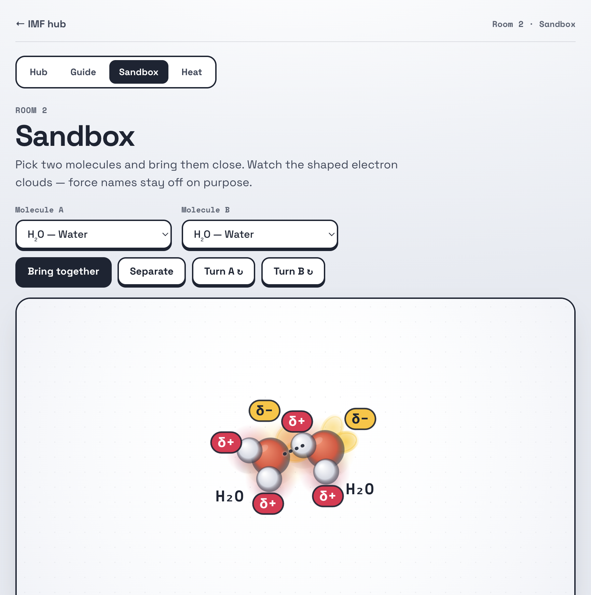

# Taste Profile: Intermolecular Forces (Chem 11H)

_Locked 2026-10-16 by user after a three-direction comparison (`taste-directions.html`)._

## Direction: Toy Box

Squishy model-kit molecules on a bright studio tray. Playful, tactile, a little game-like; the stage is the hero and the chrome stays quiet.

Rejected alternatives (kept for reference): Arcade (dark violet, neon gloss, HUD chrome) and Keynote (black spotlight, Apple-style type). See `img/direction-2-arcade.png`, `img/direction-3-keynote.png`.

## Calibration answers

| Question | Answer |
|---|---|
| Feel | Playful / tactile, with game-like energy |
| Stage vs chrome | Stage is the hero; chrome nearly disappears |
| Type | Technical / precise: grotesk plus mono for numbers |
| Quality | Production |
| Reference | Apple-style product pages (cinematic pacing; applied to Guide scroll, not to colour) |

## Charge convention (meaning colours)

**Red = δ+ / positive. Yellow = δ− / negative.** Signs, cloud tints, lone-pair lobes, induced and temporary dipoles, and ion glows all follow this one rule. No other UI may use these two colours.

| Token | Value | Use |
|---|---|---|
| `--delta-pos` | `#e8264f` | δ+ pills (white text), positive cloud tint, cation glow |
| `--delta-neg` | `#ffc21a` | δ− pills (ink text), negative cloud tint, lone-pair lobes |

Lone pairs are yellow lobes drawn over the atoms, each holding a Lewis-style pair of gold dots (`lobeDot`), so the electrons, not the O/N/F atom, are what a δ+ H docks onto. Gold dots stay distinct from the ink dotted attraction bridge.

δ signs are drawn as pills with an ink outline so yellow stays readable on the white tray, and the text sign (+ / −) always carries the meaning without colour (principle 5).

## Atom colours

Traditional model-kit hues, stylised to a soft "vinyl" palette:

| Element | Highlight → shade | Note |
|---|---|---|
| H | `#ffffff` → `#d5d9e3` | white |
| C | `#545b6e` → `#23272f` | charcoal slate |
| O | `#ff8a6a` → `#e0503a` | coral (leans orange, so it is not confused with δ+ red) |
| N | `#8494ff` → `#4152d9` | periwinkle |
| F | `#86e3b0` → `#2f9e6a` | mint |
| Cl | `#bce673` → `#69a42b` | matcha |
| Br | `#d98463` → `#8a3b22` | terracotta |
| Ne | `#86dff0` → `#2d9cb6` | aqua |
| Na⁺ | `#c9a8ff` → `#7a52e0` | lavender |

Atoms are matte with a small gloss dot, a soft rim, and a contact shadow under each atom (toys on a table).

## Field and chrome

- Page: cool off-white field `#eef1f6` with a soft top light.
- Stage: white tray, faint dot grid, 2px ink border, 22px radius, soft drop shadow.
- Controls: keycaps with a 2px ink border, 12px radius and a 3px ink drop that presses down on click. The primary button is solid ink.
- Accent (focus rings, room numbers): periwinkle `#4152d9`. Never red or yellow.
- Pull/push feedback is drawn in ink: dotted for a pull, dashed with arrowheads for a push. The two differ by shape, not colour.

## Type

- **Space Grotesk** for display, UI and body (700 for headlines, tracked −0.03em).
- **Space Mono** for labels, kickers, formulas on the stage, the status line and every number (gauges in Heat).

## Aesthetic principles

1. Charge colour is sacred: red/yellow mean δ+/δ− and nothing else.
2. Toys, not diagrams: matte volume, contact shadows and squish over line art.
3. The stage is the brightest, cleanest surface on the page.
4. Chrome is ink-on-white and tactile; pressing things should feel physical.
5. Mono means "this is a measurement or a name": numbers, formulas, status.

## Anti-patterns

- Red or yellow used for chrome, warnings or decoration.
- Glows or additive blending (they wash out on white; clouds carry colour, not light).
- Dark-mode "void lab" leftovers, and the Unit 1b paper or Rate Laws graph-paper looks.
- Haloed coloured text for δ signs (use pills).
- Em dashes (—), en dashes (–), or ` - ` used as punctuation in any user-facing copy. Prefer periods, commas, colons, or parentheses. Force names use a plain hyphen (`dipole-dipole`).
